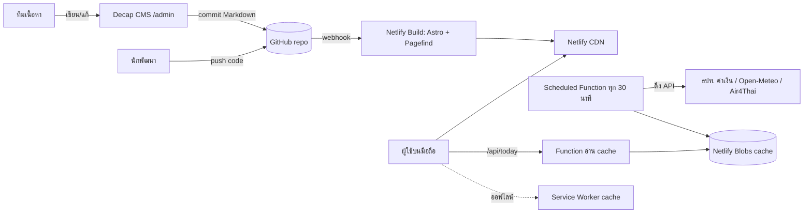
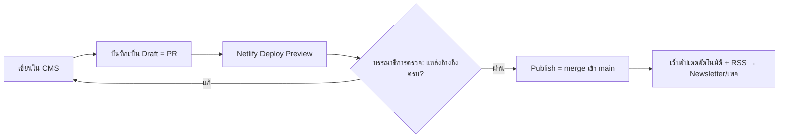

# All About Thailand: สถาปัตยกรรมโค้ดและแนวทาง UX/UI

> เอกสารร่าง v0.1 · 20 ต.ค. 2026 (พ.ศ. 2569)
> เป้าหมาย: เว็บข้อมูลและข่าวสำหรับชาวต่างชาติที่ **เร็วบนมือถือ, ติด SEO, หลายภาษา, ทีมเล็กดูแลได้**

---

## 1. หลักการออกแบบ

| หลักการ | ความหมายในทางปฏิบัติ |
|---|---|
| Mobile-first | ผู้ใช้ส่วนใหญ่เปิดจากมือถือ ที่สนามบิน ในแท็กซี่ หรือระหว่างเดินทาง ให้ออกแบบจอ 375px ก่อนจอใหญ่ |
| Static-first | หน้าทั้งหมด build เป็น HTML ล่วงหน้า โหลดเร็ว ราคาถูก ปลอดภัย |
| JavaScript น้อยที่สุด | ใช้ JS เฉพาะส่วนที่ต้องโต้ตอบ (islands) เป้าหมาย JS < 50 KB ต่อหน้า |
| เนื้อหาเชื่อถือได้ | ทุกบทความมี `sources` และ `lastChecked` บังคับใน schema |
| ใช้ได้ตอนไม่มีเน็ต | เบอร์ฉุกเฉิน วลีไทย และที่อยู่ที่พัก ต้องเปิดได้แม้ยังไม่มีซิม (PWA) |
| ทีมเล็กดูแลได้ | แก้เนื้อหาผ่าน CMS บนเว็บ ไม่ต้องแตะโค้ด |

---

## 2. Tech stack ที่แนะนำ

| ชั้น | เลือกใช้ | เหตุผล |
|---|---|---|
| Framework | **Astro 5** | Static ได้ดีมาก, มี Content Collections + i18n routing ในตัว, ส่ง JS เท่าที่จำเป็น |
| ภาษา | TypeScript | schema ของเนื้อหาตรวจสอบตอน build |
| Styling | CSS ธรรมดา + design tokens (CSS variables) | ต่อยอดจากร่างใน `index.html` ได้ทันที ไม่ต้องพึ่ง framework |
| Interactive islands | Preact (เฉพาะ widget) | เล็กแค่ ~4 KB |
| CMS | **Decap CMS** (git-based) | ฟรี เก็บเนื้อหาเป็น Markdown ใน repo ใช้ Netlify Identity ล็อกอินได้ |
| ค้นหา | **Pagefind** | ค้นหาแบบ static ไม่ต้องมี server รองรับหลายภาษา |
| ข้อมูลสด | Netlify Functions (Scheduled) | ดึงค่าเงิน อากาศ ค่าฝุ่น ทุก 30–60 นาที แล้วเก็บ cache |
| รูปภาพ | `astro:assets` + Netlify Image CDN | แปลงเป็น AVIF/WebP และย่อขนาดตามจออัตโนมัติ |
| ฟอร์ม | Netlify Forms | ติดต่อ แจ้งข้อมูลผิด |
| Newsletter | Buttondown หรือ Mailchimp | ส่งจาก RSS ของหมวดข่าวได้อัตโนมัติ |
| Analytics | Plausible หรือ Netlify Analytics | ไม่ใช้ cookie จึงไม่ต้องมี consent banner ที่รกจอมือถือ |
| Hosting | Netlify + GitHub | push ขึ้น `main` แล้ว deploy อัตโนมัติ, มี preview ทุก PR |

> ถ้าในอนาคตมีนักข่าวหลายคนลงข่าวทุกชั่วโมง ค่อยย้าย CMS ไป Sanity หรือ Strapi โดยไม่ต้องเปลี่ยนหน้าเว็บ เพราะ Content Collections แยกชั้นข้อมูลไว้แล้ว

---

## 3. ภาพรวมระบบ



---

## 4. โครงสร้างโฟลเดอร์

```text
allaboutthailand/
├─ astro.config.mjs          # i18n: en (default), zh, th · site URL · integrations
├─ netlify.toml              # build, headers, redirects, scheduled functions
├─ package.json
├─ public/
│  ├─ admin/                 # Decap CMS (index.html + config.yml)
│  ├─ icons/                 # PWA icons
│  ├─ manifest.webmanifest
│  └─ robots.txt
├─ netlify/
│  └─ functions/
│     ├─ refresh-today.ts    # scheduled: ดึงค่าเงิน/อากาศ/AQI → Blobs
│     └─ today.ts            # GET /api/today → อ่านจาก Blobs (cache 10 นาที)
├─ src/
│  ├─ content/               # เนื้อหาทั้งหมด (Markdown + frontmatter)
│  │  ├─ guides/{en,zh,th}/  # visa-exemption.md, open-bank-account.md ...
│  │  ├─ news/{en,zh,th}/
│  │  ├─ regions/            # bangkok.md, north.md ...
│  │  ├─ provinces/          # 77 จังหวัด
│  │  ├─ events/             # เทศกาล วันหยุด
│  │  ├─ phrases/            # วลีไทย + ไฟล์เสียง
│  │  └─ authors/
│  ├─ content.config.ts      # zod schema ของทุก collection
│  ├─ i18n/
│  │  ├─ en.json  zh.json  th.json   # ข้อความ UI
│  │  └─ utils.ts            # t(), getLangFromUrl(), localizedPath()
│  ├─ lib/
│  │  ├─ dates.ts            # แปลง ค.ศ. ↔ พ.ศ., รูปแบบวันที่ตามภาษา
│  │  ├─ seo.ts              # meta, hreflang, JSON-LD (NewsArticle, FAQPage)
│  │  └─ freshness.ts        # คำนวณสถานะ "ข้อมูลเก่าเกิน 90 วัน"
│  ├─ styles/
│  │  ├─ tokens.css          # สี ฟอนต์ ระยะห่าง (light/dark)
│  │  ├─ base.css
│  │  └─ utilities.css
│  ├─ components/
│  │  ├─ layout/             # Header, BottomNav, Footer, Breadcrumb, LangSwitcher
│  │  ├─ ui/                 # Button, Chip, Tag, Card, Accordion, Stepper, Sheet
│  │  ├─ content/            # SourceBox, LastChecked, Callout, TOC, ShareBar
│  │  └─ widgets/            # (islands) TodayPanel, CurrencyConverter, SOSSheet,
│  │                         #   PhraseCard, ShowToDriver, VisaChecker, SearchModal
│  ├─ layouts/
│  │  ├─ BaseLayout.astro
│  │  ├─ GuideLayout.astro
│  │  └─ NewsLayout.astro
│  └─ pages/
│     ├─ index.astro         # redirect → /en/ ตามภาษาเบราว์เซอร์
│     └─ [lang]/
│        ├─ index.astro
│        ├─ guides/[...slug].astro
│        ├─ news/index.astro  news/[slug].astro  news/category/[cat].astro
│        ├─ visit/[region].astro  visit/[region]/[province].astro
│        ├─ essentials/index.astro   # หน้าที่ cache ไว้ใช้ออฟไลน์
│        ├─ calendar.astro
│        ├─ search.astro
│        └─ rss.xml.ts
└─ docs/
   └─ ARCHITECTURE.md
```

---

## 5. Content model (schema)

ทุก collection ตรวจสอบด้วย zod ตอน build ถ้าข้อมูลไม่ครบ build จะล้ม ทำให้เนื้อหาที่ไม่มีแหล่งอ้างอิงขึ้นเว็บไม่ได้

```ts
// src/content.config.ts (ย่อ)
const source = z.object({ name: z.string(), url: z.string().url() });

const guides = defineCollection({
  loader: glob({ pattern: '**/*.md', base: './src/content/guides' }),
  schema: z.object({
    title: z.string().max(70),
    summary: z.string().max(160),            // ใช้เป็น meta description
    path: z.enum(['first-trip','visa','living','work','study','retire']),
    lang: z.enum(['en','zh','th']),
    translationKey: z.string(),              // ผูกบทความเดียวกันข้ามภาษา
    steps: z.array(z.object({ title: z.string(), detail: z.string() })).optional(),
    cost: z.object({ thb: z.number(), note: z.string() }).optional(),
    sources: z.array(source).min(1),         // บังคับต้องมีแหล่งอ้างอิง
    lastChecked: z.coerce.date(),
    offline: z.boolean().default(false),     // true = cache ไว้ให้เปิดได้ตอนออฟไลน์
  }),
});

const news = defineCollection({
  schema: z.object({
    title: z.string(),
    category: z.enum(['immigration','advisory','economy','events','transport','safety']),
    severity: z.enum(['info','important','urgent']).default('info'),
    publishedAt: z.coerce.date(),
    updatedAt: z.coerce.date().optional(),
    affects: z.array(z.string()).default([]), // เช่น ['tourists','retirees','DTV holders']
    sources: z.array(source).min(1),
    lang: z.enum(['en','zh','th']),
    translationKey: z.string(),
  }),
});
```

Collection อื่นๆ ได้แก่ `regions`, `provinces` (พิกัด, ฤดูที่ควรไป, สนามบินใกล้สุด), `events` (วันที่เริ่ม/สิ้นสุด, เป็นวันหยุดราชการหรือไม่), `phrases` (อังกฤษ, ไทย, คำอ่าน, ไฟล์เสียง)

---

## 6. URL และ i18n

| หน้า | ตัวอย่าง URL |
|---|---|
| หน้าแรก | `/en/` `/zh/` `/th/` |
| คู่มือ | `/en/guides/visa/visa-exemption` |
| ข่าว | `/en/news/2026-10-19-visa-exemption-update` |
| หมวดข่าว | `/en/news/category/immigration` |
| ภูมิภาค / จังหวัด | `/en/visit/north/chiang-mai` |
| ข้อมูลจำเป็น | `/en/essentials` |

- slug ใช้ภาษาอังกฤษทุกภาษา เพื่อให้แชร์ลิงก์ง่าย
- ใส่ `hreflang` ระหว่างภาษาจาก `translationKey`
- ถ้าบทความยังไม่มีคำแปล ให้แสดงฉบับภาษาอังกฤษพร้อมแถบแจ้งว่า "ยังไม่มีฉบับภาษานี้"

---

## 7. ข้อมูลสด (Today panel)

| ข้อมูล | แหล่ง | ความถี่ |
|---|---|---|
| อัตราแลกเปลี่ยน | Bank of Thailand API | ทุก 60 นาที (วันทำการ) |
| อากาศ | Open-Meteo (ฟรี ไม่ต้องใช้ key) | ทุก 30 นาที |
| ค่าฝุ่น PM2.5 | Air4Thai (กรมควบคุมมลพิษ) | ทุก 60 นาที |
| วันหยุดถัดไป | collection `events` | ตอน build |

ลำดับการทำงาน: `refresh-today` (scheduled) → เขียน JSON ลง Netlify Blobs → `today` ส่ง JSON พร้อม `Cache-Control: max-age=600` → island `TodayPanel` แสดงผล ถ้า API ล่มให้แสดงค่าล่าสุดพร้อมเวลาอัปเดต ไม่แสดงกล่องว่าง

---

## 8. UX/UI บนมือถือ

### 8.1 โครงหน้าจอ

```text
┌──────────────────────────┐
│ ☰  All About Thailand  🔍 │  ← Header สูง 56px ซ่อนเมื่อเลื่อนลง โผล่เมื่อเลื่อนขึ้น
├──────────────────────────┤
│ [Today: ฿33.40 · 31° · …]│  ← แถบเลื่อนแนวนอน ข้อมูลสำคัญวันนี้
│                          │
│  เนื้อหา 1 คอลัมน์        │
│  ระยะขอบ 16px            │
│                          │
│                  ( SOS ) │  ← ปุ่มลอย มุมขวาล่าง กดแล้วเปิด bottom sheet เบอร์ฉุกเฉิน
├──────────────────────────┤
│ 🏠    📘     📰    🧰   │  ← Bottom nav 4 แท็บ อยู่ในระยะนิ้วโป้ง
│ Home Guides News Essentials│
└──────────────────────────┘
```

### 8.2 การนำทาง
- **Bottom navigation 4 แท็บ:** Home · Guides · News · Essentials ส่วนค้นหาอยู่ที่ header เพราะเป็นงานที่ผู้ใช้ทำบ่อยที่สุด
- **เมนู ☰** เก็บของที่ใช้น้อย เช่น ภาษา, ปฏิทิน, เกี่ยวกับเรา, ธีมมืด/สว่าง
- **ค้นหาเปิดเต็มจอ** มีคำค้นยอดนิยมเป็น chip ("TDAC", "90-day report", "extend visa") และผลลัพธ์ขึ้นระหว่างพิมพ์ (Pagefind)
- **Breadcrumb** บนมือถือแสดงแค่ระดับก่อนหน้า (`‹ Visas`) เพื่อประหยัดพื้นที่

### 8.3 หน้าคู่มือ (Guide)
หน้าที่สำคัญที่สุด เพราะผู้ใช้มาเพื่อ "ทำเรื่องหนึ่งให้เสร็จ"
1. **กล่องสรุปด้านบน (TL;DR):** ใครต้องทำ, ค่าใช้จ่าย (บาท), ใช้เวลาเท่าไร, ทำที่ไหน
2. **ป้ายความสดใหม่:** `✓ Checked 12 Oct 2026` เป็นสีเขียว ถ้าเกิน 90 วันเปลี่ยนเป็นสีเหลือง `Being re-checked`
3. **ขั้นตอนแบบ Stepper:** แต่ละขั้นพับเก็บได้ (accordion) และมีช่องติ๊กว่าทำแล้ว (จำไว้ใน localStorage)
4. **สารบัญเป็น chip ติดด้านบน:** `On this page ▾` กดแล้วเปิดรายการหัวข้อ
5. **แหล่งอ้างอิงท้ายบทความ** พร้อมปุ่ม "แจ้งข้อมูลผิด" (Netlify Forms)
6. **ปุ่มแชร์** ไป LINE, WhatsApp, WeChat หรือคัดลอกลิงก์

### 8.4 หน้าข่าว
- การ์ดข่าวแนวนอน: รูป 96×96 ทางซ้าย, หมวด + หัวข่าว 2 บรรทัด + เวลาทางขวา
- **ระดับความสำคัญแสดงด้วยรูปทรง ไม่ใช่สีอย่างเดียว:** `urgent` มีแถบแดงด้านซ้ายพร้อมไอคอน ⚠
- ฟิลเตอร์หมวดเป็น chip เลื่อนแนวนอน และมีตัวกรอง **"กระทบกับฉัน"** (นักท่องเที่ยว / ผู้ถือ DTV / ผู้เกษียณ) จากฟิลด์ `affects`
- ข่าวที่มีการแก้ไขแสดง `Updated 20 Oct, 14:00 ICT`

### 8.5 Widget เฉพาะของเว็บนี้
| Widget | การใช้งานบนมือถือ |
|---|---|
| **SOS Sheet** | ปุ่มลอยเปิด bottom sheet แสดงเบอร์ 1155 / 191 / 1669 / 199 แบบปุ่มใหญ่ กดแล้วโทรได้ทันที (`tel:`) |
| **Show to Driver** | พิมพ์หรือวางที่อยู่ภาษาไทยแล้วแสดงเต็มจอ ตัวอักษรใหญ่ จอสว่างค้าง เพื่อยื่นให้คนขับแท็กซี่ดู |
| **Phrase Cards** | การ์ดวลีไทย ปัดซ้าย-ขวา กดฟังเสียง มีคำอ่านแบบอังกฤษ |
| **Currency Converter** | ช่องกรอกตัวเลขเปิด numpad (`inputmode="decimal"`) แปลงทันทีจากค่าใน Today panel |
| **Visa Checker** | ถาม 3 ข้อ (สัญชาติ, จุดประสงค์, ระยะเวลา) แล้วแนะนำวีซ่าพร้อมลิงก์ไปคู่มือ |

### 8.6 ใช้งานออฟไลน์ (PWA)
- ติดตั้งลงหน้าจอโฮมได้ (`manifest.webmanifest`)
- Service worker cache หน้า `/essentials`, เบอร์ฉุกเฉิน, วลีไทย และคู่มือที่ตั้ง `offline: true`
- แสดงป้าย `Available offline ✓` บนหน้าที่ cache ไว้แล้ว
- แนะนำผู้ใช้ให้ "บันทึกไว้ก่อนบิน" ในหน้า First trip

### 8.7 กติกาการออกแบบ
| เรื่อง | ค่าที่ใช้ |
|---|---|
| ขนาดจุดกด | อย่างน้อย 44×44px และห่างกันอย่างน้อย 8px |
| ตัวอักษร | เนื้อหา 16–17px, ระยะบรรทัด 1.6, ไม่เกิน ~65 ตัวอักษรต่อบรรทัด |
| ฟอนต์ | Chonburi (หัวเรื่อง), Anuphan (เนื้อหา, รองรับไทย-อังกฤษ), IBM Plex Mono (ตัวเลข), เพิ่ม Noto Sans SC สำหรับภาษาจีน |
| สี | Indigo (แบรนด์), Saffron (ปุ่มหลัก), Jade (สถานะผ่าน/ลิงก์), แดง (เตือน) · มีโหมดมืดทุกหน้า |
| Contrast | WCAG 2.2 AA ขั้นต่ำ 4.5:1 |
| ฟอร์ม | ใช้ `inputmode` และ `autocomplete` ให้ถูกต้อง, label อยู่เหนือช่องกรอก |
| Motion | เคารพ `prefers-reduced-motion`, ใช้ transition สั้น 150–200ms |
| Safe area | รองรับ notch / home indicator ด้วย `env(safe-area-inset-*)` โดยเฉพาะ bottom nav |
| โหมดประหยัดเน็ต | ถ้า `navigator.connection.saveData` เปิดอยู่ ไม่โหลดรูปใหญ่และวิดีโอ |

### 8.8 เป้าหมายประสิทธิภาพ (มือถือ 4G ระดับกลาง)
| ตัวชี้วัด | เป้าหมาย |
|---|---|
| LCP | < 2.0 วินาที |
| INP | < 200 ms |
| CLS | < 0.05 |
| JS ต่อหน้า | < 50 KB (gzip) |
| น้ำหนักหน้าแรก | < 500 KB |
| Lighthouse Mobile | ≥ 95 ทุกหมวด |

วัดอัตโนมัติด้วย Lighthouse CI ทุก PR ถ้าต่ำกว่าเป้า PR จะไม่ผ่าน

---

## 9. SEO และการแชร์
- JSON-LD: `NewsArticle` สำหรับข่าว, `HowTo` และ `FAQPage` สำหรับคู่มือ, `Event` สำหรับเทศกาล
- สร้าง Open Graph image อัตโนมัติต่อบทความ (ชื่อบทความบนพื้น indigo) ให้แชร์ใน Facebook/LINE แล้วดูดี
- `sitemap.xml` แยกตามภาษา, RSS ต่อภาษา (ใช้โพสต์เพจอัตโนมัติได้)

---

## 10. การทำงานของทีม (workflow)



- งานตามรอบ: ทุกสัปดาห์ระบบสร้างรายการคู่มือที่ `lastChecked` เกิน 90 วัน ให้ทีมตรวจซ้ำ
- `CODEOWNERS`: หมวด visa และ legal ต้องให้บรรณาธิการอนุมัติเท่านั้น

---

## 11. Roadmap

| เฟส | ระยะเวลา | ขอบเขต |
|---|---|---|
| **1. MVP** | 4–6 สัปดาห์ | ย้ายร่างเป็น Astro, ภาษาอังกฤษ, คู่มือหลัก 20 เรื่อง, ข่าว, Essentials, ค้นหา, Decap CMS |
| **2. Mobile+** | 4 สัปดาห์ | PWA ออฟไลน์, SOS sheet, Show to Driver, Today panel ข้อมูลจริง, Newsletter |
| **3. ขยาย** | 6 สัปดาห์ | ภาษาจีนและไทย, 77 จังหวัด, Visa Checker, ปฏิทินเทศกาล |
| **4. รายได้และชุมชน** | ต่อเนื่อง | Affiliate (ประกัน, eSIM, ที่พัก), พื้นที่โฆษณา, Q&A จากผู้อ่าน |
